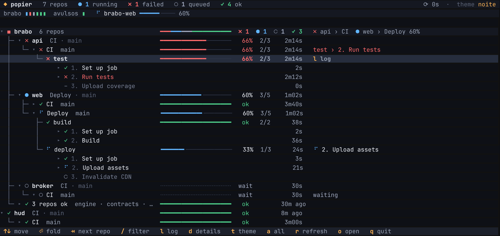
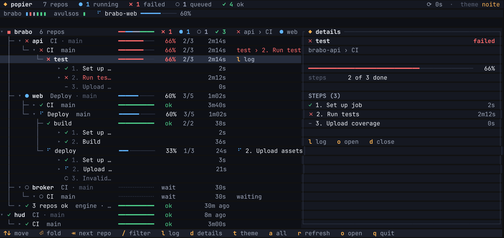
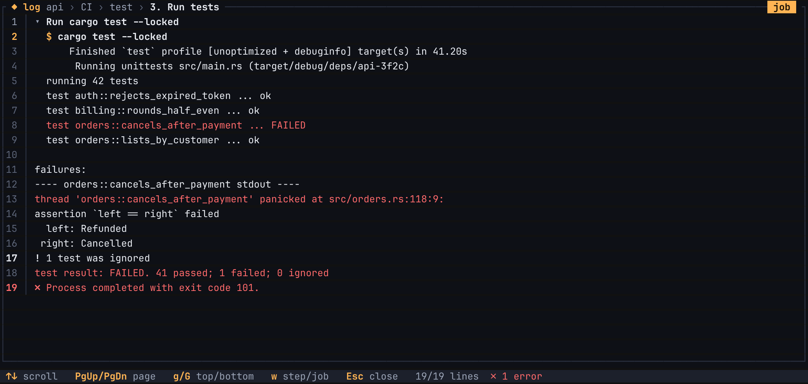
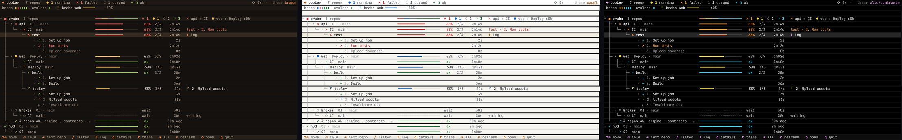

<div align="center">

# ◆ popier

**Every GitHub Actions pipeline you care about, live, on one terminal screen.**

Many repos, one tree: **repo → workflow → job → step**, with progress bars,
failing steps called out, logs one key away, and a desktop ping when `main` breaks.

[](https://github.com/viralabs-dev/popier/actions/workflows/ci.yml)
[](https://github.com/viralabs-dev/popier/releases/latest)
[](#license)
[](https://www.rust-lang.org)
[](#install)
[](https://ko-fi.com/daneiel)



</div>

## Why popier

Opening a browser tab per repo to find out *which* pipeline broke, *where*,
and *whether* the fix is still running gets old fast, especially for a
project spread over many repositories. popier keeps all of it in one live view.

- **One tree for everything.** The latest run of every workflow in every repo,
  down to each job and step, refreshed every minute.
- **Problems surface first.** Failed, running and queued pipelines open by
  themselves; green ones stay folded and quiet. The failing step is named right
  on the workflow line: `test › 2. Run tests`.
- **Projects, not just repos.** Group a multi-repo project into one row with
  a health bar (`✗ 1 ● 1 ○ 1 ✓ 3`) and the reasons it needs you.
- **Logs without leaving the terminal.** `l` shows just the failing step's
  output, cut from the job log; `Enter` on a step previews its last lines inline.
- **Zero setup with `gh`.** `popier init --discover` finds your repos and
  writes the config, grouping `brabo`, `brabo-api`, `brabo-web`… automatically.
- **Desktop notifications** when a workflow starts failing, and when it recovers.
- **Five themes**, from dark to light to high contrast, or your terminal's own colors.
- **Light on the API.** ETag caching means unchanged data doesn't count against
  your rate limit. Single static binary, no runtime.

## Quick start

```sh
# 1. get the static Linux binary
curl -sSL https://github.com/viralabs-dev/popier/releases/latest/download/popier-x86_64-unknown-linux-musl.tar.gz | tar xz
install -m 755 popier ~/.local/bin/

# 2. let it find your repos (uses your `gh` login)
popier init --discover

# 3. watch
popier
```

<table>
<tr>
<td width="50%"></td>
<td width="50%"></td>
</tr>
<tr>
<td align="center"><b>Details sidebar</b> (<code>d</code>): everything about the selected row</td>
<td align="center"><b>Step log</b> (<code>l</code>): only the step that failed, errors highlighted</td>
</tr>
</table>

`✓` success · `●` running · `○` queued · `✗` failed · `–` skipped · `⊘` cancelled

## Install

**Prebuilt binary (Linux x86_64):** download `popier-x86_64-unknown-linux-musl.tar.gz`
(static, any distro) or `popier-x86_64-unknown-linux-gnu.tar.gz` from the
[latest release](https://github.com/viralabs-dev/popier/releases/latest):

```sh
curl -sSL https://github.com/viralabs-dev/popier/releases/latest/download/popier-x86_64-unknown-linux-musl.tar.gz | tar xz
install -m 755 popier ~/.local/bin/
```

**From source** (Rust 1.85+):

```sh
cargo install --git https://github.com/viralabs-dev/popier
```

Notifications use `notify-send` (libnotify), available on most Linux desktops.

## Setup

The quickest start, if you use the `gh` CLI:

```sh
popier init --discover   # finds your repos and writes ~/.config/popier/config.toml
```

It lists every repository your GitHub login can see, keeps the ones with active
workflows (no archived repos or forks), and groups repos of one owner that share
a name prefix, like `brabo`, `brabo-api` and `brabo-web`. Useful flags:
`--owner <org>` (repeatable) to limit it to some owners, `--public` to keep
only public repositories (handy for a demo or a shared screen), `--print` to see the
result without writing it, `--force` to replace an existing config.

Or start from a sample and edit it:

```sh
popier init          # writes ~/.config/popier/config.toml
$EDITOR ~/.config/popier/config.toml
```

The config lists repositories in display order:

```toml
[settings]
refresh_secs = 60        # seconds between refreshes
expand = "attention"     # "attention" (running/queued/failed) or "all"
runs_per_repo = 30       # recent runs scanned per repo
notify = true            # desktop notification when a workflow fails / recovers
notify_branches = []     # only notify for these branches (empty = all)

[[repo]]
slug = "your-org/your-repo"

[[repo]]
slug = "your-org/another-repo"
label = "another"        # optional display name
branch = "main"          # optional branch filter
```

A project made of several repositories can be a group. The group gets its own
row on a band: `◼` in the worst state of its repos, a health bar with one
segment per state, the count per state and up to two reasons (`✗ api › CI`).
Inside an open group, repos are shown without the shared prefix (`brabo-api` →
`api`), those needing attention first; three or more green repos fold into one
`✓ N repos ok` line that Enter opens. The header's pulse strip is split by
group. A slug listed only in a group is watched with default options.

```toml
[[group]]
name = "brabo"
repos = ["your-org/brabo", "your-org/brabo-api", "your-org/brabo-web"]
```

See [`examples/config.toml`](examples/config.toml) for the full sample.

### Authentication

popier talks to the GitHub REST API directly. The token is taken from, in
order: `GITHUB_TOKEN`, `GH_TOKEN`, then `gh auth token`. If you already use the
`gh` CLI, nothing else is needed.

## Usage

```sh
popier               # interactive dashboard
popier once          # print the tree once and exit
popier once --all    # expand every workflow
popier once --logs   # then the last 30 lines of every failing step (--log-lines N)
popier -c other.toml # use another config file
```

### Keys

| Key | Action |
|---|---|
| `↑` `↓` / `j` `k` | move |
| `Enter` / `Space` | fold or unfold a repo or workflow (unfolding fetches its jobs); on a step, show the end of its log right below it |
| `Tab` / `Shift+Tab` | next / previous project or repo (wraps around: after the last comes the first) |
| `/` | filter by part of a branch name, or `#152` for a PR (applies as you type; `Esc` clears) |
| `l` | show the log of the selected step (or job) in a panel; inside it `w` toggles step/whole job, `Esc` closes |
| `a` | toggle expanding every workflow |
| `r` | refresh now |
| `d` / `→` | open or close the details sidebar on the right (`←` closes it) |
| mouse | click a row to select it and fold or unfold it; the wheel scrolls (hold `Shift` to select text) |
| `t` | next color theme (noite → brasa → papel → alto-contraste → terminal) |
| `o` | open the selected item in the browser |
| `q` / `Esc` | quit (`Esc` clears an active filter first) |

## Look and themes



Each workflow and job shows a progress bar (finished steps out of all steps),
the percent, the `done/total` count and how long it has run. A repo line, open
or folded, sums up its most urgent pipeline (failed, then running, then
queued), so a folded repo still tells you what is going on. The header counts
repos per state and shows a strip with one `▮` per repo plus a mini bar for
each pipeline running now.

```toml
[settings]
theme = "noite"   # noite, brasa, papel (light), alto-contraste, terminal
bar = "line"      # "line" ━━━━╸──── or "block" ████▌░░░░
```

Without `theme`, popier uses `noite` on true-color terminals and `terminal`
(your terminal's own 16 colors) elsewhere. A custom theme is a file
`~/.config/popier/themes/<name>.toml` with any of the design tokens, e.g.
`running = "#62b6ff"`; tokens left out come from `noite`. Token names: `bg`,
`surface`, `surface-raised`, `selection`, `line`, `track`, `ink`, `muted`,
`faint`, `accent`, `on-accent`, `running`, `queued`, `success`, `failure`,
`skipped`, `cancelled`.

## Details sidebar

`d` (or `→`) opens a panel on the right with everything popier knows about the
selected row, and it follows the selection as you move:

- **group**: health bar, repos per state, what needs attention, every repo with its lead pipeline;
- **repo**: slug, lead pipeline progress, every workflow with branch, bar and last run;
- **workflow**: wide progress bar, steps done, when it started, how long it took, run id, where it failed, its jobs;
- **job**: progress and every step with its duration;
- **step**: position in the job, start, duration and state.

On terminals narrower than 90 columns the panel covers the tree; `d`, `←` or
`Esc`-free navigation keep working, and `d` closes it.

### Upright monitors

On a tall, narrow terminal (at least 30 rows, and twice as many rows as
columns, as on a monitor turned on its side) the panel goes under the tree,
full width, instead of to its right. The key hints wrap onto a second line
instead of being cut, and between 64 and 80 columns the tree keeps a short
progress bar.

## Filtering

`/` opens a filter field in the footer. Text matches part of the head branch
(case-insensitive); `#152` matches runs of pull request 152. The filter applies
to the recent runs already scanned per repo (`runs_per_repo`), so a branch with
no run among them shows as "(no runs)". Notifications pause while a filter is
on. For a permanent per-repo branch filter, use `branch` in the config.

## Step logs

`l` on a step opens a panel with the last 200 lines of that step; `w` switches
to the whole job log, `Esc` closes. GitHub serves logs per job only, so popier
downloads the job log once (kept in memory for the session) and cuts the step
at its `##[group]Run …` marker, up to the next step's marker (falling back to
the step's start and end times when it has none). If the step can't be found, the end of the job log
is shown with a note. The download follows GitHub's redirect to a signed
storage URL without sending your token there.

## Notifications

While the dashboard is open, popier sends a desktop notification
(`notify-send`) when a workflow that was in any other state starts failing,
and a low-urgency one when a failing workflow passes again. Nothing is sent
for failures that were already there when popier started, and each run is
announced at most once. Turn it off with `notify = false`, or limit it with
`notify_branches = ["main", "dev"]`.

## API usage

Each refresh makes two requests per repository (recent runs and workflow names)
plus one per expanded workflow.
Responses are cached with their ETag, so unchanged data comes back as
`304 Not Modified`, which does not count against the 5,000 requests/hour limit.
The footer shows the remaining quota.

## Development

```sh
cargo test
cargo clippy --all-targets -- -D warnings
cargo fmt
```

Architecture notes live in [`docs/architecture.md`](docs/architecture.md).

## Releasing

Push a tag `vX.Y.Z` matching the version in `Cargo.toml`; the release workflow
builds the Linux binaries (glibc and static musl) and attaches them to a GitHub release.

## Contributing

Issues and pull requests are welcome. Run the checks in [Development](#development)
before opening a PR; CI runs the same ones.

## Support

If popier saves you a few browser tabs, you can [buy me a coffee on Ko-fi](https://ko-fi.com/daneiel).

## License

Licensed under either of [Apache License 2.0](LICENSE-APACHE) or
[MIT license](LICENSE-MIT), at your option. Contributions are accepted under
the same terms.
